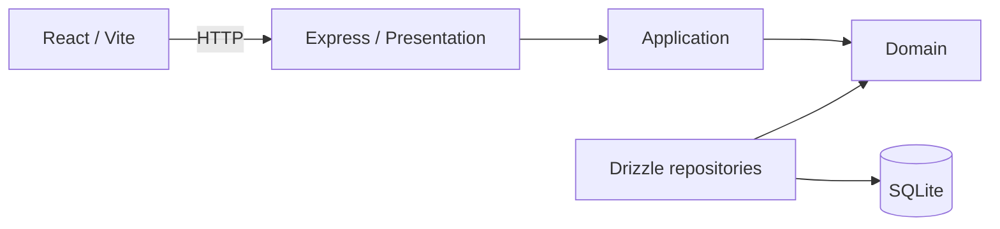

<p align="center">
  
</p>

<p align="center">
  <strong>Controle financeiro pessoal, simples e local.</strong><br />
  Organize contas, categorias e lançamentos em um único lugar.
</p>

<p align="center">
  
</p>

<p align="center">
  
  
  
  
  
  
  
  
</p>

<p align="center">
  <a href="#recursos">Recursos</a> ·
  <a href="#guia-de-uso">Guia de uso</a> ·
  <a href="#como-executar">Como executar</a> ·
  <a href="#desenvolvimento">Desenvolvimento</a>
</p>

## Sobre o projeto

O Pocket Ledger é uma aplicação local para acompanhar a vida financeira diária. Ela oferece uma visão consolidada de receitas, despesas e saldo, com dados armazenados em SQLite e uma interface web responsiva.

O projeto é um monorepo pnpm com frontend React e API Express. Não há autenticação: a aplicação foi pensada para uso local.

## Recursos

- Dashboard mensal com saldo, receitas, despesas e distribuição por categoria.
- Cadastro de contas com saldo inicial e saldo atualizado por lançamentos.
- Categorias de receita e despesa, com cores personalizadas.
- Criação de transações em um fluxo guiado por etapas.
- Lançamentos parcelados e recorrentes.
- Exclusão com confirmação e histórico de auditoria.
- Inicia no modo escuro, com opção para alternar para o tema claro.
- Navbar com logo adaptado ao tema e fundo interativo com partículas que acompanha o cursor.
- Interface disponível em português brasileiro e inglês.

## Guia de uso

### 1. Cadastre suas contas

Abra **Contas**, selecione **Nova conta** e informe um nome e o saldo inicial. O saldo exibido na lista considera os lançamentos realizados posteriormente.

### 2. Crie categorias

Em **Categorias**, crie categorias de receita ou despesa e escolha uma cor. A categoria determina automaticamente o tipo do lançamento durante a criação de uma transação.

### 3. Registre uma transação

Na página **Transações**, selecione **Novo lançamento**.

1. Na primeira etapa, escolha a conta e a categoria, depois informe descrição e valor. Caso necessário, crie uma nova categoria sem sair do modal.
2. Na segunda, defina data, número de parcelas e, para despesas, informe se o gasto é fixo e sua duração.
3. Confirme em **Salvar lançamento**.

O tipo da transação é preenchido automaticamente a partir da categoria escolhida. Gastos fixos são registrados como lançamentos recorrentes pelo período informado; lançamentos parcelados e recorrentes são salvos como registros individuais para manter o histórico auditável.

### 4. Acompanhe seus dados

Use o mês selecionado no dashboard e na página de transações para consultar o período desejado. O histórico registra criações e exclusões realizadas na aplicação.

## Como executar

### Pré-requisitos

- Node.js 22 ou superior
- pnpm 10 ou superior

### Instalação

No PowerShell, a partir da raiz do projeto:

```powershell
pnpm install
Copy-Item .env.example apps/api/.env
pnpm --filter @pocket-ledger/api db:generate
pnpm --filter @pocket-ledger/api db:migrate
pnpm --filter @pocket-ledger/api db:seed
pnpm dev
```

Depois, abra:

| Serviço       | Endereço                           |
| ------------- | ---------------------------------- |
| Interface web | `http://localhost:5173`            |
| API           | `http://127.0.0.1:3333`            |
| Health check  | `http://127.0.0.1:3333/api/health` |

### Configuração

Copie `.env.example` para `apps/api/.env` antes de iniciar a API. As variáveis disponíveis são:

| Variável       | Descrição                       | Padrão                      |
| -------------- | ------------------------------- | --------------------------- |
| `DATABASE_URL` | Caminho para o banco SQLite     | `file:./dev.db`             |
| `PORT`         | Porta da API                    | `3333`                      |
| `HOST`         | Endereço de escuta da API       | `127.0.0.1`                 |
| `VITE_API_URL` | URL base da API para o frontend | `http://127.0.0.1:3333/api` |

## Desenvolvimento

### Comandos

| Comando                                          | Descrição                                         |
| ------------------------------------------------ | ------------------------------------------------- |
| `pnpm dev`                                       | Inicia API e frontend em modo de desenvolvimento. |
| `pnpm build`                                     | Gera o build de todos os workspaces.              |
| `pnpm lint`                                      | Executa ESLint em todos os workspaces.            |
| `pnpm typecheck`                                 | Executa a checagem de tipos.                      |
| `pnpm test`                                      | Executa testes unitários e de integração.         |
| `pnpm test:e2e`                                  | Executa testes E2E do frontend.                   |
| `pnpm --filter @pocket-ledger/api test:coverage` | Executa os testes da API com cobertura via c8.    |
| `pnpm --filter @pocket-ledger/api test:mutation` | Executa os testes de mutação da API com Stryker.  |
| `pnpm format`                                    | Formata o projeto com Prettier.                   |
| `pnpm format:check`                              | Verifica a formatação com Prettier.               |

### Testes, cobertura e mutação

Para comparar somente unidades isoladas da API, use `pnpm --filter @pocket-ledger/api test:unit`. O comando `test:unit:coverage` executa essa seleção com c8 e mostra a cobertura de branches. A suíte geral continua incluindo os testes funcionais e de integração.

Os testes ficam próximos da aplicação que validam. A API usa o runner nativo `node:test`; o frontend usa Vitest para testes unitários e Playwright em modo headless para testes E2E.

```text
apps/
├── api/
│   ├── tests/
│   │   ├── application/               # Testes de casos de uso
│   │   ├── presentation/              # Testes de rotas HTTP
│   │   └── shared/                    # Testes de utilitários compartilhados
│   ├── tsconfig.test.json             # Compilação isolada dos testes da API
│   ├── stryker.config.json            # Configuração dos testes de mutação
│   ├── scripts/generate-c8-report.mjs # Gera o HTML a partir do resumo do c8
│   ├── C8_COVERAGE_REPORT.html        # Relatório de cobertura atual
│   └── MUTATION_TEST_REPORT.html      # Relatório de mutação ou status da execução
└── web/
    ├── tests/
    │   ├── features/                  # Testes de features
    │   ├── lib/                       # Testes de utilitários de interface
    │   ├── schemas/                   # Testes de schemas de formulário
    │   └── e2e/                       # Testes E2E com Playwright
    └── PLAYWRIGHT_COVERAGE_REPORT.html # Disponibilidade de cobertura E2E
```

- `pnpm test` executa os testes unitários e de integração de todos os workspaces. Na API, os arquivos TypeScript são compilados temporariamente em `dist-test/` antes da execução com `node --test`.
- `pnpm test:e2e` inicia uma API com SQLite isolado, aplica as migrações, inicia o Vite e executa o Playwright headless. O teste usa `localhost:5173`, origem já permitida pelo CORS da API.
- `pnpm --filter @pocket-ledger/api test:coverage` executa a suíte da API com c8, produz os dados auxiliares em `coverage/` e atualiza [C8_COVERAGE_REPORT.html](apps/api/C8_COVERAGE_REPORT.html). Na última execução: 81,26% de linhas e instruções, 85,71% de funções e 90,67% de ramificações.
- O Playwright valida o comportamento E2E, mas ainda não instrumenta o bundle para medir cobertura de código. [PLAYWRIGHT_COVERAGE_REPORT.html](apps/web/PLAYWRIGHT_COVERAGE_REPORT.html) documenta essa limitação.
- `pnpm --filter @pocket-ledger/api test:mutation` executa o Stryker com a suíte unitária e muta domínio, serviço de transações, schemas e datas. Na última execução: 212 de 255 mutantes mortos (83,14%), 43 sobreviventes e nenhum timeout ou erro. O relatório está em [MUTATION_TEST_REPORT.html](apps/api/MUTATION_TEST_REPORT.html). A configuração usa 20 workers e `timeoutMS: 30000`.

Os diretórios transitórios `coverage/`, `dist-test/`, `.stryker-tmp/`, `reports/`, `playwright-report/` e `test-results/` são ignorados pelo Git. Os três HTMLs de relatório acima são mantidos fora do `.gitignore` para poderem ser versionados.

### Banco de dados

O banco usa SQLite e Drizzle ORM. Valores monetários são armazenados como centavos inteiros e datas são enviadas no formato `YYYY-MM-DD`.

Após alterar o schema, gere e aplique uma migração:

```powershell
pnpm --filter @pocket-ledger/api db:generate
pnpm --filter @pocket-ledger/api db:migrate
```

Para popular o banco com exemplos:

```powershell
pnpm --filter @pocket-ledger/api db:seed
```

## Arquitetura



| Área                          | Responsabilidade                                                    |
| ----------------------------- | ------------------------------------------------------------------- |
| `apps/web`                    | Interface React organizada por features, hooks, services e schemas. |
| `apps/api/src/presentation`   | Rotas HTTP, validação de entrada e composição da API.               |
| `apps/api/src/application`    | Casos de uso e orquestração de regras.                              |
| `apps/api/src/domain`         | Regras financeiras e contratos de persistência.                     |
| `apps/api/src/infrastructure` | Implementações Drizzle dos contratos do domínio.                    |
| `apps/api/src/db`             | Cliente SQLite, schema, migrações e seed.                           |

Para detalhes de cada aplicação, consulte [o README do frontend](apps/web/README.md) e [o README da API](apps/api/README.md).

## Licença

Este projeto é distribuído gratuitamente sob a licença [MIT](LICENSE), que permite uso, modificação e redistribuição, desde que os avisos de copyright e de licença sejam mantidos.

## Convenções de engenharia

As regras locais do projeto ficam em [AGENTS.md](AGENTS.md) e na [skill de engenharia](.codex/skills/pocket-ledger-engineering/SKILL.md). Elas cobrem organização de código, validação, documentação e commits semânticos.
