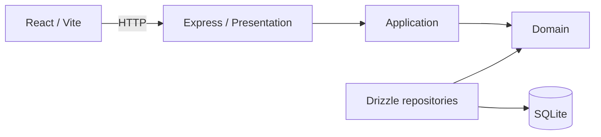

<p align="center">
  
</p>

<p align="center">
  <strong>Controle financeiro pessoal, simples e local.</strong><br />
  Organize contas, categorias e lançamentos em um único lugar.
</p>

<p align="center">
  <a href="https://github.com/rdavi/pocket-ledger/actions/workflows/ci.yml">
    
  </a>
</p>

<p align="center">
  <a href="#recursos">Recursos</a> ·
  <a href="#guia-de-uso">Guia de uso</a> ·
  <a href="#como-executar">Como executar</a> ·
  <a href="#desenvolvimento">Desenvolvimento</a>
</p>

## Sobre o projeto

O Pocket Ledger é uma aplicação local para acompanhar a vida financeira diária. Ela oferece uma visão consolidada de receitas, despesas e saldo, com dados armazenados em SQLite e uma interface web responsiva.

O projeto é um monorepo pnpm com frontend React e API Express. Não há autenticação: a aplicação foi pensada para uso local.

## Recursos

- Dashboard mensal com saldo, receitas, despesas e distribuição por categoria.
- Cadastro de contas com saldo inicial e saldo atualizado por lançamentos.
- Categorias de receita e despesa, com cores personalizadas.
- Criação de transações em um fluxo guiado por etapas.
- Lançamentos parcelados e recorrentes.
- Exclusão com confirmação e histórico de auditoria.
- Temas claro, escuro e automático.
- Interface disponível em português brasileiro e inglês.

## Guia de uso

### 1. Cadastre suas contas

Abra **Contas**, selecione **Nova conta** e informe um nome e o saldo inicial. O saldo exibido na lista considera os lançamentos realizados posteriormente.

### 2. Crie categorias

Em **Categorias**, crie categorias de receita ou despesa e escolha uma cor. A categoria determina automaticamente o tipo do lançamento durante a criação de uma transação.

### 3. Registre uma transação

Na página **Transações**, selecione **Novo lançamento**.

1. Na primeira etapa, escolha a conta e a categoria, depois informe descrição e valor. Caso necessário, crie uma nova categoria sem sair do modal.
2. Na segunda, defina data, número de parcelas e, para despesas, informe se o gasto é fixo e sua duração.
3. Confirme em **Salvar lançamento**.

O tipo da transação é preenchido automaticamente a partir da categoria escolhida. Gastos fixos são registrados como lançamentos recorrentes pelo período informado; lançamentos parcelados e recorrentes são salvos como registros individuais para manter o histórico auditável.

### 4. Acompanhe seus dados

Use o mês selecionado no dashboard e na página de transações para consultar o período desejado. O histórico registra criações e exclusões realizadas na aplicação.

## Como executar

### Pré-requisitos

- Node.js 20 ou superior
- pnpm 10 ou superior

### Instalação

No PowerShell, a partir da raiz do projeto:

```powershell
pnpm install
Copy-Item .env.example apps/api/.env
pnpm --filter @pocket-ledger/api db:generate
pnpm --filter @pocket-ledger/api db:migrate
pnpm --filter @pocket-ledger/api db:seed
pnpm dev
```

Depois, abra:

| Serviço       | Endereço                           |
| ------------- | ---------------------------------- |
| Interface web | `http://localhost:5173`            |
| API           | `http://127.0.0.1:3333`            |
| Health check  | `http://127.0.0.1:3333/api/health` |

### Configuração

Copie `.env.example` para `apps/api/.env` antes de iniciar a API. As variáveis disponíveis são:

| Variável       | Descrição                       | Padrão                      |
| -------------- | ------------------------------- | --------------------------- |
| `DATABASE_URL` | Caminho para o banco SQLite     | `file:./dev.db`             |
| `PORT`         | Porta da API                    | `3333`                      |
| `HOST`         | Endereço de escuta da API       | `127.0.0.1`                 |
| `VITE_API_URL` | URL base da API para o frontend | `http://127.0.0.1:3333/api` |

## Desenvolvimento

### Comandos

| Comando             | Descrição                                         |
| ------------------- | ------------------------------------------------- |
| `pnpm dev`          | Inicia API e frontend em modo de desenvolvimento. |
| `pnpm build`        | Gera o build de todos os workspaces.              |
| `pnpm lint`         | Executa ESLint em todos os workspaces.            |
| `pnpm typecheck`    | Executa a checagem de tipos.                      |
| `pnpm test`         | Executa testes unitários e de integração.         |
| `pnpm test:e2e`     | Executa testes E2E do frontend.                   |
| `pnpm format`       | Formata o projeto com Prettier.                   |
| `pnpm format:check` | Verifica a formatação com Prettier.               |

### Banco de dados

O banco usa SQLite e Drizzle ORM. Valores monetários são armazenados como centavos inteiros e datas são enviadas no formato `YYYY-MM-DD`.

Após alterar o schema, gere e aplique uma migração:

```powershell
pnpm --filter @pocket-ledger/api db:generate
pnpm --filter @pocket-ledger/api db:migrate
```

Para popular o banco com exemplos:

```powershell
pnpm --filter @pocket-ledger/api db:seed
```

## Arquitetura



| Área                          | Responsabilidade                                                    |
| ----------------------------- | ------------------------------------------------------------------- |
| `apps/web`                    | Interface React organizada por features, hooks, services e schemas. |
| `apps/api/src/presentation`   | Rotas HTTP, validação de entrada e composição da API.               |
| `apps/api/src/application`    | Casos de uso e orquestração de regras.                              |
| `apps/api/src/domain`         | Regras financeiras e contratos de persistência.                     |
| `apps/api/src/infrastructure` | Implementações Drizzle dos contratos do domínio.                    |
| `apps/api/src/db`             | Cliente SQLite, schema, migrações e seed.                           |

Para detalhes de cada aplicação, consulte [o README do frontend](apps/web/README.md) e [o README da API](apps/api/README.md).

## Convenções de engenharia

As regras locais do projeto ficam em [AGENTS.md](AGENTS.md) e na [skill de engenharia](.codex/skills/pocket-ledger-engineering/SKILL.md). Elas cobrem organização de código, validação, documentação e commits semânticos.
