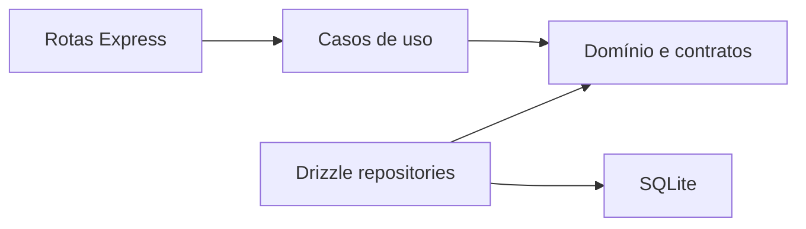

# API

Local Express API for Pocket Ledger. The `domain` layer does not depend on Express or Drizzle; `application` orchestrates rules; `infrastructure` implements persistence; and `presentation` translates HTTP.



`src/domain` accepts only rules and contracts. `src/application` depends on the domain. `src/infrastructure` contains Drizzle, and `src/presentation` contains Express/Zod. Recurring and installment transactions are materialized when created; editing or deleting affects only the selected transaction.

## Directory structure

```text
apps/api/
├── drizzle/                         # Generated database migrations and snapshots
├── src/
│   ├── application/                  # Use cases and orchestration
│   │   └── transaction-service.ts
│   ├── db/                           # Drizzle client, schema, migration, and seed scripts
│   │   ├── client.ts
│   │   ├── migrate.ts
│   │   ├── schema.ts
│   │   └── seed.ts
│   ├── domain/                       # Financial rules and repository contracts
│   │   ├── financial.ts
│   │   └── repositories.ts
│   ├── infrastructure/               # Drizzle implementations of domain contracts
│   │   └── drizzle-repositories.ts
│   ├── presentation/                 # HTTP composition root
│   │   ├── controllers/              # HTTP entry ports and their validation schemas
│   │   │   ├── controller-api.ts
│   │   │   └── schema-api.ts
│   │   └── app.ts                    # Public HTTP app export
│   ├── shared/                       # Framework-independent utilities
│   │   └── date.ts
│   └── server.ts                     # HTTP server entry point
├── test/                             # Unit and integration tests
├── drizzle.config.ts                 # Drizzle Kit configuration
├── package.json
└── tsconfig.json
```
