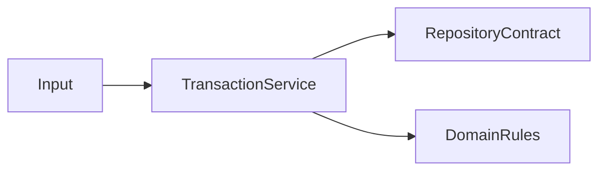

# Application

Casos de uso que coordenam regras do domínio e contratos de repositório. Não dependem de HTTP ou de SQLite.

Parcelas e recorrências são materializadas de forma atômica, com arredondamento em centavos preservando o total.
