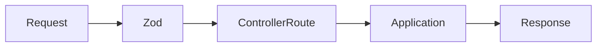

# Presentation

Express routes, HTTP serialization, and Zod validation. The `controllers` directory is the HTTP entry port: `controller-api.ts` registers the routes and `schema-api.ts` centralizes the request schemas for the financial API. Domain and validation errors return standardized responses.

