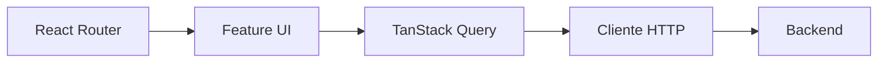

# Frontend

Aplicação React organizada por feature. Cada feature concentra tela, modelos e hooks próprios; `lib` expõe detalhes compartilhados, como o cliente HTTP.

## Design system and themes

Semantic UI tokens live in `src/styles.css`. They are grouped into interface,
financial, and chart tokens. The `.dark` class overrides token values only,
so components do not need separate light and dark implementations.

`src/hooks/use-theme.ts` persists a `light`, `dark`, or `system`
preference under `pocket-ledger-theme`. The script in `index.html` resolves
the stored or system preference before React starts, avoiding a theme flash.

Recharts configuration is centralized in `src/lib/chart-colors.ts`. Financial
series use semantic tokens. Category colours use a stable hash of the category
identifier, so they do not change when lists are sorted differently. Legends
remain visible so colour is not the sole signal.

As telas dependem da API somente por `lib/api.ts`. Variáveis CSS semânticas em `styles.css` permitem alternância light/dark persistida localmente. Componentes e mensagens são em português brasileiro; identificadores de código são em inglês.
