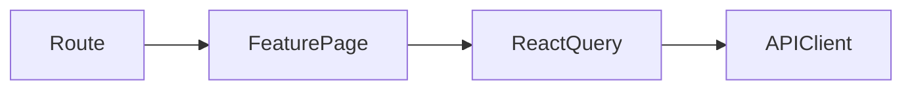

# Features

Telas e comportamento visual por funcionalidade. As features chamam hooks de consulta e mutação; somente `services` conhece o cliente HTTP. Os schemas de formulário vivem em `src/schemas`.

